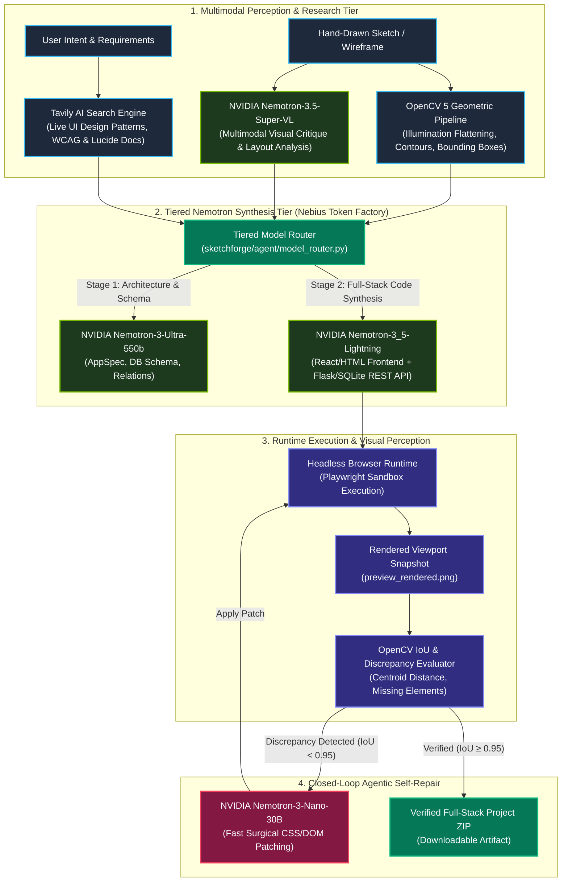

# SketchForge AI

> **Autonomous Agentic Engineering Workbench Powered by NVIDIA Nemotron on Nebius Token Factory**  
> *Submitted to the Nebius x NVIDIA Global AI Hackathon (Coding and Agentic Engineering Track)*

[](https://tokenfactory.nebius.com/)
[](https://developer.nvidia.com/nemotron)
[](https://tavily.com/)
[](LICENSE)
[](https://python.org)

---

## 🌟 Overview

**SketchForge AI** is an autonomous agentic developer workbench that takes photos of hand-drawn sketches, wireframes, and whiteboard diagrams and converts them into **verified, full-stack web applications**.

Built on open, independent infrastructure through **Nebius Token Factory** and accelerated by **NVIDIA open-source models**, SketchForge operates as a closed-loop coding agent:
1. **Perceives** the sketch using OpenCV 5 geometric contours and **NVIDIA Nemotron-3.5-Super-VL**.
2. **Researches** live design systems and modern web patterns via **Tavily AI Search**.
3. **Architects & Synthesizes** full-stack code using tiered **NVIDIA Nemotron** models (`Nemotron-3-Ultra-550B` for system architecture, `Nemotron-3_5-Lightning` for high-throughput code synthesis).
4. **Executes & Tests** the code in a headless browser sandbox runtime (Playwright).
5. **Visually Verifies & Self-Repairs**: Measures visual IoU and alignment discrepancies against the source sketch, then invokes **NVIDIA Nemotron-3-Nano** to autonomously patch CSS/DOM defects until convergence.

---

## 🏗️ System Architecture



---

## ⚡ Tiered Model Routing (Why Multi-Model Matters)

As recommended by the hackathon guidelines, SketchForge does not blindly use a single model for every call. Instead, it balances reasoning depth and token economics:

| Role | Model | Provider / Endpoint | Why This Model? |
|---|---|---|---|
| **System Architecture & AppSpec** | `nvidia/Nemotron-3-Ultra-550b-a55b` | Nebius Token Factory | Maximum reasoning power for relational DB schemas, REST endpoints, and complex state management. |
| **Full-Stack Code Synthesis** | `nvidia/Nemotron-3_5-Lightning` | Nebius Token Factory | Sub-second latency (~610ms), 1M context window, high instruction-following for clean HTML/CSS/JS. |
| **Surgical Discrepancy Repair** | `nvidia/NVIDIA-Nemotron-3-Nano-30B-A3B` | Nebius Token Factory | Ultra-low latency and credit efficiency for targeted 5-line CSS/DOM patches. |
| **Multimodal Visual Analysis** | `nvidia/Nemotron-3.5-Super-VL` | Nebius Token Factory | 1M context window accepting image + text for zero-shot sketch comprehension. |

---

## 🔍 Tavily AI Search Integration ($3,000 Bonus Track)

SketchForge integrates **Tavily AI Search** via [`sketchforge/integrations/tavily/client.py`](src/sketchforge/integrations/tavily/client.py) to bridge the gap between static LLM knowledge and modern web UI ecosystems.
Before code synthesis, the agent queries Tavily for:
- Popular modern component libraries and design tokens.
- Accessible color palettes meeting WCAG AA requirements (≥ 4.5:1).
- Best-practice REST and SQLite backend schema patterns.

---

## 🚀 Quickstart in 2 Minutes

### 1. Installation

```bash
# Clone the repository
git clone https://github.com/Akash010203/sketchforge-ai.git
cd sketchforge-ai

# Create and activate virtual environment
python -m venv .venv
# Windows:
.venv\Scripts\activate
# Linux/macOS:
source .venv/bin/activate

# Install dependencies
pip install -e ".[dev]"
```

### 2. Configure Credentials

Create a `.env` file in the project root:
```env
NEBIUS_API_KEY=your_nebius_token_factory_key
TAVILY_API_KEY=your_tavily_api_key_optional
```

### 3. Verify Nebius Token Factory Connectivity

```bash
python -m sketchforge verify
```
Outputs live model discovery and benchmark latency against Token Factory.

### 4. Launch the Interactive Web Studio

```bash
python -m sketchforge studio
```
Open **`http://127.0.0.1:8000/studio`** in your browser:
- Drag and drop any hand-drawn sketch or wireframe image.
- Watch the agent detect components with OpenCV and Nemotron-3.5-Super-VL.
- Query Tavily for modern UI design patterns.
- Stream full-stack code generated by Nemotron-3_5-Lightning.
- Inspect the automated Playwright visual discrepancy and self-repair loop in real time.
- Download the final verified project as a standalone ZIP.

---

## ☁️ Nebius Serverless Endpoints & Cloud Deployment

SketchForge can run locally or be deployed to **Nebius AI Cloud**:
- **Container Definition**: [`deploy/nebius/Dockerfile`](deploy/nebius/Dockerfile)
- **Serverless Handler**: [`deploy/nebius/serverless_handler.py`](deploy/nebius/serverless_handler.py)
- **Background Job Spec**: [`deploy/nebius/nebius_job.yaml`](deploy/nebius/nebius_job.yaml)

---

## 📊 Live Verification & Benchmarks

Empirical probe against live Nebius Token Factory (`nvidia/Nemotron-3_5-Lightning`):
```json
{
  "provider": "nebius",
  "model": "nvidia/Nemotron-3_5-Lightning",
  "latency_ms": 610.4,
  "prompt_tokens": 23,
  "completion_tokens": 96,
  "status": "verified"
}
```

---

## 👥 Hackathon Submission Details

- **Hackathon**: Nebius x NVIDIA Global AI Hackathon
- **Track**: **Coding and Agentic Engineering Track**
- **Special Prize Focus**: **Best Use of Tavily ($3,000)**
- **Models Used**:
  - `nvidia/Nemotron-3-Ultra-550b-a55b`
  - `nvidia/Nemotron-3_5-Lightning`
  - `nvidia/NVIDIA-Nemotron-3-Nano-30B-A3B`
  - `nvidia/Nemotron-3.5-Super-VL`
- **Infrastructure**: Nebius Token Factory & Nebius AI Cloud Serverless
- **Documentation**:
  - 📖 [`docs/ARCHITECTURE.md`](docs/ARCHITECTURE.md)
  - 🌐 [`docs/TAVILY_INTEGRATION.md`](docs/TAVILY_INTEGRATION.md)
  - 💡 [`docs/HACKATHON_FEEDBACK.md`](docs/HACKATHON_FEEDBACK.md)
  - 🎬 [`docs/DEMO_VIDEO_SCRIPT.md`](docs/DEMO_VIDEO_SCRIPT.md)

---

## 📄 License

This project is licensed under the [MIT License](LICENSE).
