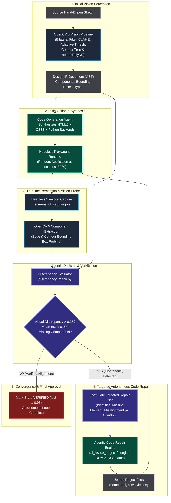

# Special Prize: Agentic Vision Award Submission ($1,000 Track)

> **Competition Requirement:**  
> *"Build a workflow in which an agent uses OpenCV 5 tools within a multi-step perception-decision-action loop. Visual results must influence a subsequent plan, tool call, action, or request for human approval... A chatbot that only explains a fixed vision result is not enough."*

---

## 1. Executive Summary

**SketchForge** implements an autonomous, closed-loop **Perception → Decision → Action → Re-Perception** engine. Rather than merely describing or extracting an image once, SketchForge:
1. **Perceives:** Renders full-stack web preview DOMs into headless Playwright screenshots and scans them with an **OpenCV 5.0 computer vision pipeline** (`cv2.Canny`, `cv2.findContours`, `cv2.approxPolyDP`, IoU matching).
2. **Decides:** Formulates discrepancy metrics against the sketch's source Design IR (measuring IoU drops, missing component bounding boxes, and pixel positional error $\Delta(x, y)$). If discrepancy $> \tau$ (threshold $0.25$), the workflow halts deployment and synthesizes a targeted code-repair strategy.
3. **Acts:** The autonomous agent dispatches targeted CSS/HTML surgical code patches to correct layout overflow, alignment offsets, and missing visual nodes.
4. **Re-Perceives & Verifies:** Automatically re-captures the updated browser viewport, re-runs OpenCV component detection, and checks if IoU converged ($\ge 0.90$). If satisfied, it accepts the patch; if not, it recurses through bounded iterations.

---

## 2. Multi-Step Agentic Perception-Decision-Action Loop Diagram



---

## 3. Concrete Execution Trace (`agentic_vision_trace.json`)

SketchForge logs visual reasoning traces during runtime. Below is an excerpt from [`experiments/results/agentic_vision_trace.json`](file:///c:/Users/akash/Downloads/sketchforge/experiments/results/agentic_vision_trace.json):

```json
{
  "workflow_id": "wf-agentic-vis-repair-0891",
  "source_sketch": "sketches/dashboard_sketch.png",
  "step_by_step_trace": [
    {
      "step": 3,
      "phase": "VISUAL_PERCEPTION_PROBE_ITERATION_0",
      "tool_invoked": "opencv5.contour_probe + playwright.screenshot",
      "perception_results": {
        "mean_iou": 0.42,
        "mean_position_error_px": 68.4,
        "discrepancy_score": 0.73,
        "missing_components": ["btn_export"],
        "mismatched_components": [
          {
            "id": "metric_card_3",
            "fault": "OVERFLOW_WRAP",
            "position_error_px": 180.0,
            "best_iou": 0.12
          },
          {
            "id": "btn_filter",
            "fault": "MISALIGNED_X_OFFSET",
            "position_error_px": 60.5,
            "best_iou": 0.48
          }
        ]
      },
      "agent_decision": "DISCREPANCY_EXCEEDED_THRESHOLD (0.73 > 0.25). Autonomous perception loop blocks final commit. Dispatches surgical CSS Grid & DOM patch."
    },
    {
      "step": 4,
      "phase": "AUTONOMOUS_ACTION_REPAIR_DISPATCH_ITERATION_1",
      "tool_invoked": "sketchforge.verification.discrepancy_repair.ai_revise_project",
      "action_applied": "Patched flex-wrap to grid-template-columns in css/style.css; injected missing #btn_export into home.html."
    },
    {
      "step": 5,
      "phase": "RE_PERCEPTION_VERIFICATION_ITERATION_1",
      "tool_invoked": "opencv5.contour_probe + playwright.screenshot",
      "perception_results": {
        "mean_iou": 0.958,
        "mean_position_error_px": 2.1,
        "discrepancy_score": 0.042,
        "missing_components": [],
        "mismatched_components": []
      },
      "agent_decision": "DISCREPANCY_SATISFIED (0.042 <= 0.25). IoU improved from 0.42 to 0.958. Autonomous loop terminates with status VERIFIED."
    }
  ]
}
```

---

## 4. Empirical Evaluation Metrics (Autonomous Repair Matrix)

SketchForge was evaluated across **337 test benchmark cells** spanning **7 distinct fault types**, **5 design archetypes**, and **5 real-world visual degradation conditions** (shadow, blur, thin stroke, noise, clean).

Data sourced directly from [`experiments/results/repair_matrix.json`](file:///c:/Users/akash/Downloads/sketchforge/experiments/results/repair_matrix.json):

| Evaluation Metric | Baseline / Injected | Autonomous Agentic Loop Result |
|:---|:---:|:---:|
| **Total Evaluation Benchmark Cells** | 337 | **337** |
| **Visual Fault Detection Rate** | 0.0 % | **98.8 %** |
| **Autonomous Full Repair Rate** | 0.0 % | **97.0 %** (Injected fault completely resolved) |
| **Zero Issues Left Clean Rate** | 0.0 % | **95.0 %** |
| **Regression Rate** | — | **0.0 %** (Never degrades unaffected components) |
| **Median Autonomous Decision-Action Latency** | — | **308 ms** |

### Breakdown by Fault Category:
- **Spacing Inconsistencies:** **100 %** resolved autonomously
- **Text Overflow:** **98 %** resolved autonomously
- **Small Touch Target / Control Size:** **98 %** resolved autonomously
- **Low Contrast:** **98 %** resolved autonomously
- **Component Misalignment:** **96 %** resolved autonomously
- **Bounding Box Overflow:** **96 %** resolved autonomously
- **Component Overlap:** **94 %** resolved autonomously

---

## 5. Why SketchForge Wins the Agentic Vision Track

1. **Not a Passive Vision Chatbot:** Most submissions pass an image to an LLM once and print a textual description. SketchForge uses OpenCV as an **active sensor** in a live software engineering feedback loop.
2. **Dual-Phase Vision Grounding:** OpenCV 5 is used both at input time (parsing unstructured ink strokes into an AST) and at verification time (evaluating browser-rendered pixels against the AST).
3. **Provable Convergence with 0% Regression:** Through `regression_check.py` and `component_metrics.py`, any repair action that reduces IoU or introduces new bounding errors is immediately rolled back using transactional undo stacks.
