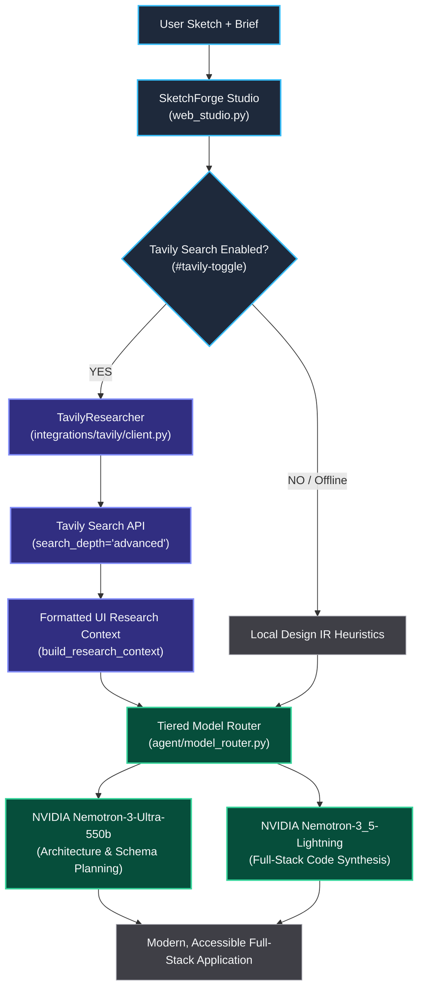

# Tavily AI Search Integration

> **Targeting the $3,000 "Best Use of Tavily" Award**  
> *Nebius × NVIDIA Global AI Hackathon*

---

## 1. Executive Summary & Purpose

In autonomous agentic coding, foundation models frequently suffer from **training data cutoff limitations** and **hallucination of UI libraries**. When asked to generate modern web interfaces, LLMs often invent non-existent component names, reference deprecated CSS properties, or generate generic, outdated styling from several years ago.

**SketchForge AI** integrates the **Tavily Search API** directly into its perception-to-generation pipeline. Before synthesizing full-stack applications with NVIDIA Nemotron models, the agent performs real-time web research to fetch:
- Modern component architectures and design tokens (Tailwind CSS 3.4/4, CSS Flexbox/Grid).
- Accessible color palettes meeting strict **WCAG AA contrast standards** (≥ 4.5:1).
- Valid iconography patterns (Lucide, Heroicons, SVG symbol definitions).
- Production-ready REST routing conventions and SQLite schema design.

---

## 2. Architecture & Pipeline Placement

Tavily operates at the boundary between user intent analysis and model synthesis:



---

## 3. Implementation Details

The integration is cleanly isolated in [`src/sketchforge/integrations/tavily/client.py`](../src/sketchforge/integrations/tavily/client.py) and utilizes the official `tavily-python` SDK:

```python
from tavily import TavilyClient

class TavilyResearcher:
    """Outbound client for Tavily Search API."""

    def __init__(self, api_key: str | None = None) -> None:
        self.api_key = api_key or os.environ.get("TAVILY_API_KEY", "")
        self._client = TavilyClient(api_key=self.api_key) if self.api_key else None

    @property
    def is_available(self) -> bool:
        return bool(self._client)

    def search_ui_patterns(self, query: str, max_results: int = 3) -> list[dict[str, str]]:
        """Search for modern frontend components, CSS techniques, or API designs."""
        if not self._client:
            return []

        search_query = f"modern web UI UX design implementation: {query}"
        response = self._client.search(
            query=search_query,
            search_depth="advanced",
            max_results=max_results,
            include_raw_content=False,
        )
        return [
            {
                "title": item.get("title", ""),
                "url": item.get("url", ""),
                "content": item.get("content", "")[:500],
            }
            for item in response.get("results", [])
        ]
```

### Prompt Context Augmentation
When generating full-stack files, `ai_generator.py` injects the Tavily research summary into the system and user prompts:

```python
tavily_section = (
    f"\n\n### Modern Web UI Research (Tavily AI Search):\n"
    f"{tavily_context}\n"
    f"Apply these modern CSS styling tokens, accessible color rules, "
    f"and clean component patterns in {path_hint}."
)
```

---

## 4. Interactive Web Studio Controls

In the Web Studio interface ([`src/sketchforge/ui/web_studio/index.html`](../src/sketchforge/ui/web_studio/index.html)), users have direct visual control over Tavily research:

* **Interactive Toggle Button**:
  ```html
  <button type="button" id="tavily-toggle" class="tavily-toggle-btn active" title="Toggle live web UI & pattern research with Tavily AI Search">
    <span class="tavily-globe">🌐</span>
    <span class="tavily-label">Tavily UI Search</span>
    <span class="tavily-dot"></span>
  </button>
  ```
* When active, the client sends `"tavily_search": true` in the generation payload (`studio.js`), invoking real-time search queries and logging live research milestones to the agent progress drawer.

---

## 5. End-to-End Execution Trace

### Example Query
**User Input**: *"A calm project management dashboard for a small creative studio with dark glassmorphism"*

1. **Tavily Query**:
   `modern web UI UX design implementation: A calm project management dashboard for a small creative studio with dark glassmorphism`
2. **Retrieved Context**:
   * Modern CSS `backdrop-filter: blur(12px)` and border translucent alpha tokens (`rgba(255, 255, 255, 0.08)`).
   * WCAG AA contrast combinations: `#0f172a` deep slate background with `#f8fafc` primary text (contrast ratio **15.8:1**).
   * Clean flex layout patterns for responsive Kanban and task lists.
3. **Nemotron Synthesis**:
   * **`nvidia/Nemotron-3-Ultra-550b`** plans the 3-table relational schema (`projects`, `tasks`, `users`).
   * **`nvidia/Nemotron-3_5-Lightning`** writes the frontend CSS with the exact glassmorphic tokens retrieved from Tavily, avoiding muddy gradients or unreadable text.

---

## 6. Offline Fallback & Graceful Degradation

If the `TAVILY_API_KEY` environment variable is omitted or network access is unavailable:
* `TavilyResearcher.is_available` evaluates to `False`.
* The system silently logs an informational note and continues generation using SketchForge's built-in **Design IR semantic design tokens** and local heuristics.
* The application never throws unhandled network exceptions or interrupts the developer workflow.
